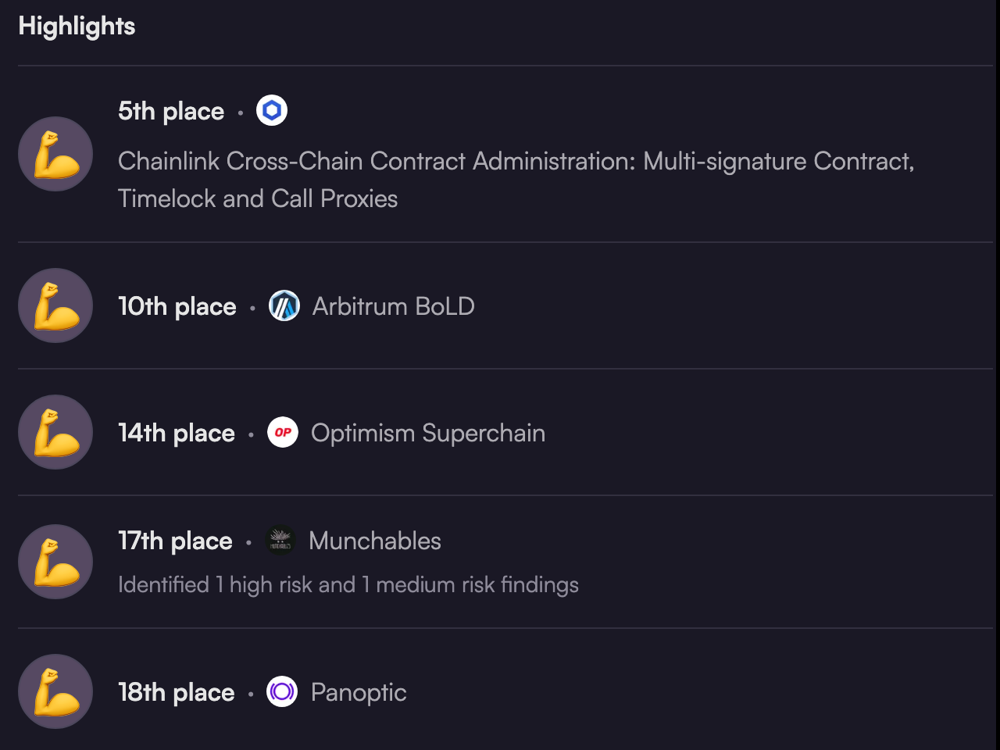

# Hi, I'm Trevor Tian

Blockchain security engineer. I review smart contracts and protocol code, reproduce real exploits, and trace stolen funds on-chain. Before security I spent six years building Java backends, so I'm comfortable reviewing node and backend code, not only contracts.

These days I do most of my building by running many AI coding agents in parallel.

## Selected work

- **Immunefi: 1st place, Fluid Protocol audit competition.** Ranked 1st of 7 in an invite-only competition on Fuel Network (Sway code). I found both valid issues myself (1 Critical, 1 Medium); they were submitted through the EXVUL team account. [Leaderboard](https://immunefi.com/audit-competition/iop-fluid-protocol/leaderboard/)
- **Code4rena: 7 High and 18 Medium valid findings.** Top-20 finishes include Chainlink cross-chain contract administration (5th), Arbitrum BoLD (10th) and Optimism Superchain (14th). Example: a High in Revolution Protocol that was the primary issue and selected for the final report ([#210](https://github.com/code-423n4/2023-12-revolutionprotocol-findings/issues/210)).
- **Cantina: 23 public findings.** Best finish 7th of 50 (Pegasus, 2024).
- **DeFiHackLabs: exploit PoCs.** Reproduced the Thoreum Finance and DFS Finance attacks as runnable Foundry tests. Merged: [#196](https://github.com/SunWeb3Sec/DeFiHackLabs/pull/196), [#174](https://github.com/SunWeb3Sec/DeFiHackLabs/pull/174)
- **Morph L2: code review.** Reviewed 36 pull requests across the node ([morph-l2/morph](https://github.com/morph-l2/morph/pulls?q=is%3Apr+reviewed-by%3Atwcctop)) and the execution client ([morph-l2/go-ethereum](https://github.com/morph-l2/go-ethereum/pulls?q=is%3Apr+reviewed-by%3Atwcctop)), 2025–2026.
- **EXVUL Sec: audit reports.** EVM and Solana audits I worked on as a security auditor, 2024–2025. [Public reports](https://github.com/EXVUL-Sec/AuditReport)
- **WTF-Solidity: oracle manipulation lesson.** Wrote lesson S15, with a vulnerable contract and a Foundry test. [#361](https://github.com/AmazingAng/WTF-Solidity/pull/361)

## Find me

[Code4rena](https://code4rena.com/@twcctop) · [Cantina](https://cantina.xyz/u/twcctop) · [Sherlock](https://audits.sherlock.xyz/watson/twcctop) · [X](https://x.com/twcctop) · [LinkedIn](https://www.linkedin.com/in/twcctop)

**Stack:** Solidity · Foundry · Go · Java · JavaScript · Python · EVM · Solana
